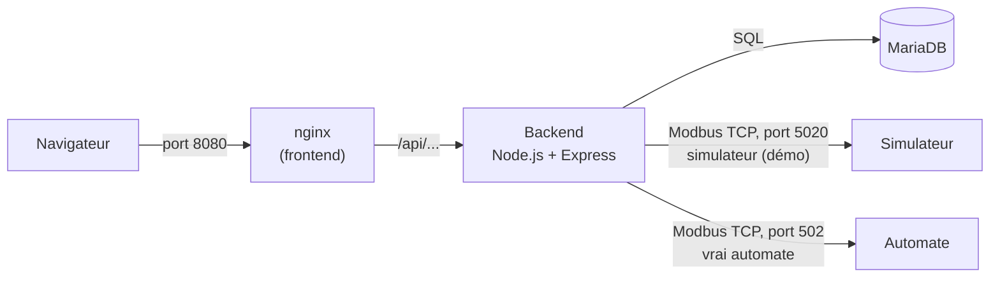
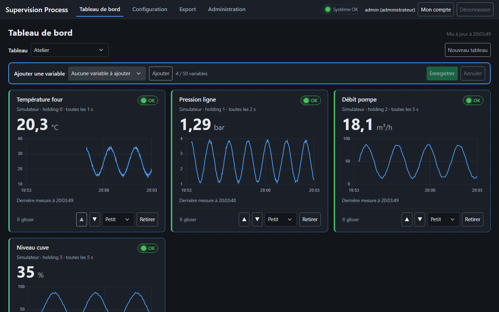
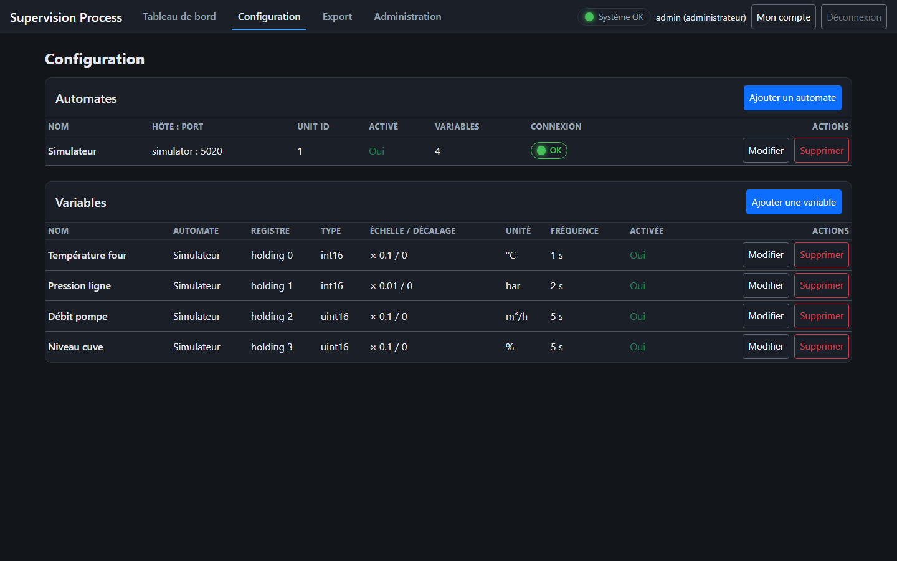
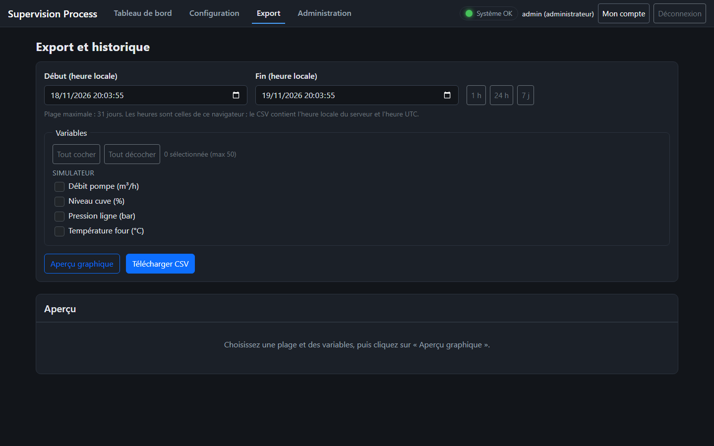
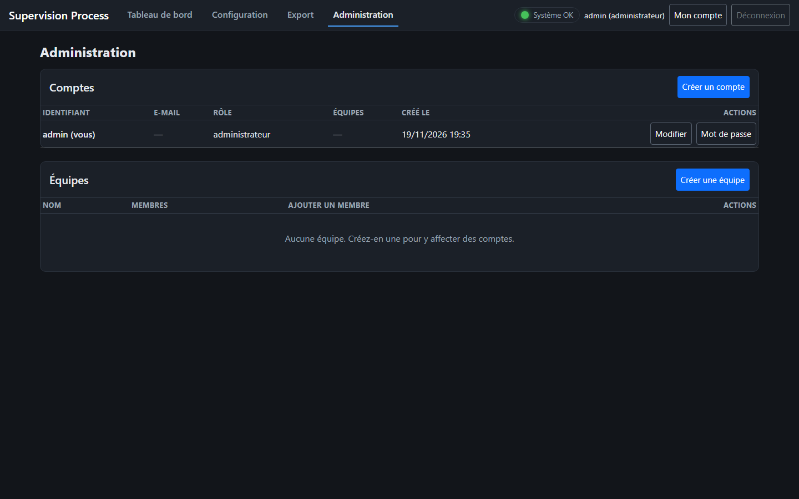
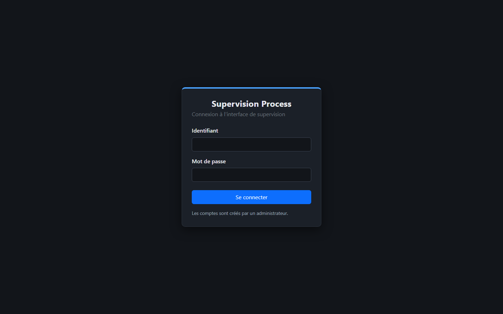

# Développement d’une Solution de Relevé de Données Process

Dans un environnement industriel de plus en plus connecté, disposer d’outils capables de récupérer et d’exploiter les
données des process est devenu essentiel pour surveiller en temps réel, prévenir les pannes, optimiser la
consommation énergétique, et maintenir les standards de qualité. Ces données contribuent ainsi à une meilleure
performance globale et à la réduction des coûts.

Cependant, les outils de supervision actuels, souvent basés sur des technologies propriétaires, présentent plusieurs
inconvénients :

- Coût élevé : Des licences et matériels onéreux qui impactent les budgets d’investissement.
- Dépendance aux fournisseurs externes : Un manque d’autonomie pour ajuster et personnaliser les outils en
fonction des besoins spécifiques.
- Rigidité : Des systèmes peu flexibles, limitant leur adaptabilité aux évolutions rapides des besoins.
  
# Enjeux & Défis

Ce projet vise à créer une solution de suivi indépendante et flexible, permettant aux industriels de surveiller leurs
process en toute autonomie et à moindre coût, tout en répondant à différents besoins. Cette solution permettrait :
- Une indépendance technologique : S’affranchir des solutions propriétaires pour éviter les coûts de licence et
gagner en autonomie.
- Adaptabilité et déploiement rapide : Mettre en place les outils de suivi efficacement, notamment en cas de
besoin urgent de visibilité sur les données.
- Flexibilité et modularité : Adapter les systèmes de suivi aux besoins spécifiques de chaque installation.

En s’appuyant sur des technologies open source, cette solution offre aux industriels un contrôle total sur leur suivi de
données sans dépendance vis-à-vis de fournisseurs tiers. Elle est conçue pour être facilement déployable, modulable,
et paramétrable afin que les techniciens puissent définir eux-mêmes les automates et variables à surveiller. Plus qu’une
simple solution technique, il s’agit de développer un outil stratégique pour l’industrie, qui répond aux exigences
d’autonomie et de résilience tout en restant accessible financièrement

# Description de l’application

Votre mission est de concevoir un prototype de solution de suivi modulaire et portable, pensé pour s’adapter à divers
environnements industriels. Cette application open source doit fournir aux industriels un outil de suivi indépendant et
flexible, capable de surveiller en temps réel les variables critiques d’automates (par exemple, température, pression).
Elle doit permettre aux utilisateurs de configurer facilement les adresses IP des automates et les variables à surveiller
via une interface intuitive. Les données collectées seront affichées sur un tableau de bord interactif pour faciliter
l’analyse et la prise de décision. Pensée pour un déploiement rapide sur un réseau local, cette application représente
une alternative aux solutions propriétaires, offrant une autonomie totale tout en minimisant les coûts.

# Objectifs de l'application

1. Paramétrage des variables : Une interface simple pour configurer les paramètres des automates et définir les
variables à surveiller.
2. Supervision en temps réel : Un tableau de bord clair et interactif pour visualiser les variables monitorées.
3. Utilisation de solutions open source : Un développement basé sur des technologies libres pour garantir
indépendance et maîtrise des coûts.
4. Déploiement rapide : Une architecture permettant une installation en quelques minutes, adaptée aux besoins
urgents de supervision.

# Parcours utilisateur envisagé
Le parcours utilisateur met en lumière les fonctionnalités clés auxquelles les techniciens ou ingénieurs auront accès
pour surveiller et exploiter les données en temps réel et historique.

1. Accès à l’application : L’application est accessible via un navigateur sur le réseau local de l’entreprise.
L’utilisateur (technicien, ingénieur, etc.) peut accéder aux fonctionnalités de configuration et de supervision.
2. Configuration des paramètres : L’utilisateur peut ajouter ou modifier les paramètres des variables à surveiller.
Pour chaque variable, il peut définir le nom, l’adresse IP de l’automate, la variable à lire, et la fréquence
d’enregistrement. Ces paramètres sont sauvegardés dans la base de données pour être utilisés par le backend.
3. Supervision en temps réel : Pour chaque variable surveillée, un tableau de bord affiche les données en temps
réel sous forme de graphiques. Ce graphique se met à jour automatiquement en fonction de la fréquence
d’enregistrement configurée. Cette interface simple permet à l’utilisateur d’interpréter les résultats
rapidement sans autre logiciel spécifique.
4. Consultation des données historiques : Les données des variables surveillées peuvent être exportées via une
interface dotée d’un formulaire permettant de définir une plage de dates. L’export se fait au format CSV, afin
de faciliter leur exploitation dans d’autres outils spécifiques ou leur partage avec d’autres équipes.

# Parcours Backend envisagé

Le parcours backend détaille les processus invisibles qui orchestrent la récupération des données des automates, leur
stockage et leur mise à disposition pour le frontend.

1. Initialisation et Chargement des Paramètres : Au démarrage, le backend se connecte à la base de données
pour récupérer la liste des variables à surveiller (IP des automates, registres à lire, fréquence, etc.). Il initialise
les tâches périodiques de supervision en fonction des paramètres configurés.
2. Surveillance et Lecture des Automates : Le backend lit et les variables automate à surveiller, à intervalles
réguliers, en fonction de la fréquence définie pour chaque variable dans la base de données. Il gère les
connexions Modbus et gère les erreurs en cas de défaillance de connexion ou de lecture.
3. Enregistrement des Données en Base : Après chaque lecture, les valeurs récupérées sont sauvegardées dans
la base de données, avec un horodatage. Cette historisation permet la consultation et l’export des données par
les utilisateurs.
4. API REST pour le Frontend : Le backend expose des routes pour permettre au frontend de notamment :
o Ajouter, modifier ou supprimer des paramètres de surveillance.
o Afficher les valeurs de la variable surveillée pour interprétation sous graphique depuis le frontend.
o Récupérer les données historiques pour une période donnée et les mettre à disposition en
téléchargement via un fichier CSV.
5. Gestion des Tâches Périodiques : Le backend surveille en continu les variables configurées grâce à des tâches
périodiques (par exemple, avec node-cron ou un équivalent). Ces tâches s'adaptent dynamiquement : si des
modifications sont apportées dans la configuration (par exemple, ajout d'une nouvelle variable), elles sont
prises en compte sans nécessiter de redémarrage du serveur.
6. Déploiement et Accessibilité : Le backend est déployé dans un conteneur Docker et configuré pour écouter
sur un port spécifique. Il est accessible depuis d’autres machines du réseau pour communiquer avec le frontend
ou d’autres services.

---

## Relevé de données process

L'application relève à intervalles réguliers des valeurs (température, pression…) sur des automates, en Modbus TCP. Chaque valeur est enregistrée avec sa date et son heure dans MariaDB, puis affichée en graphique dans le navigateur. Une plage de dates s'exporte en CSV, qui s'ouvre directement dans Excel en français.

Le projet est un travail d'étudiants. Il tourne entièrement dans Docker, sur un réseau local, sans logiciel propriétaire.

## Schéma



## Quick start

À faire une seule fois : installer **Docker Desktop** (Windows, avec WSL2) ou Docker Engine avec Docker Compose v2. Rien d'autre : ni Node.js ni MariaDB ne sont à installer.

1. **Démarrer Docker Desktop** et attendre que son icône indique « Engine running ».
2. **Ouvrir un terminal à la racine du projet** (le dossier qui contient `docker-compose.yml`).
3. **Créer le fichier `.env`** :
   ```powershell
   Copy-Item .env.example .env     # Git Bash / Linux / macOS : cp .env.example .env
   ```
4. **Éditer `.env`** : remplacer chaque valeur `change-me-...` par un vrai mot de passe (4 au total : root, api, poller, admin). Sans apostrophe ni guillemet. `ADMIN_PASSWORD` fait 10 caractères au minimum. Ne plus modifier les mots de passe SQL ensuite (voir « Dépannage »).
5. **Lancer** :
   ```bash
   docker compose up -d --build
   ```
   Le premier lancement télécharge les images et prend quelques minutes.
6. **Vérifier** que les 4 services sont `healthy` ou `Up` :
   ```bash
   docker compose ps
   ```
7. **Ouvrir http://localhost:8080** et se connecter avec `ADMIN_USERNAME` / `ADMIN_PASSWORD` du `.env`.

Le simulateur Modbus est déjà configuré : dès la connexion, les graphiques se remplissent sans autre réglage.

### Commandes utiles

| Action | Commande |
|---|---|
| Arrêter, en gardant les données | `docker compose down` |
| Redémarrer | `docker compose up -d` |
| Voir les journaux | `docker compose logs -f backend` |
| Reconstruire après un changement de code | `docker compose up -d --build` |
| **Tout effacer** (base, mesures, comptes) | `docker compose down -v` |

### Première connexion

Le compte administrateur est créé au premier démarrage, avec `ADMIN_USERNAME` et `ADMIN_PASSWORD` définis dans `.env`. Connectez-vous avec ces valeurs, puis changez le mot de passe dans « Mon compte ».

### Dépannage

| Symptôme | Cause et remède |
|---|---|
| `failed to connect to the docker API` | Docker Desktop n'est pas démarré. Le lancer, puis relancer la commande. |
| `ADMIN_PASSWORD manquant dans .env` | Le fichier `.env` n'existe pas ou la variable est vide. Reprendre l'étape 3 et 4. |
| Connexion refusée avec le bon mot de passe, journaux backend : `Access denied for user 'api'` | Les mots de passe du `.env` ont changé après la création de la base. MariaDB ne les relit pas quand son volume existe déjà. Remettre les anciens mots de passe, ou repartir de zéro avec `docker compose down -v` puis `docker compose up -d --build` (**efface toutes les données**). |
| `ADMIN_PASSWORD` modifié mais l'ancien mot de passe est toujours demandé | Le compte admin n'est créé que si aucun compte n'existe. Changer le mot de passe dans « Mon compte », ou repartir de zéro comme ci-dessus. |
| Port 8080 ou 3000 déjà utilisé | Changer `APP_PORT` ou `API_PORT` dans `.env`, puis `docker compose up -d`. |
| Page blanche juste après le lancement | Le backend démarre encore. Attendre quelques secondes (`docker compose ps`). |

### Mise à jour d'une base déjà créée

Les scripts de `db/init` ne tournent que sur une base neuve. Si la base existe depuis avant une mise à jour, appliquer les fichiers de `db/migrations/` dans l'ordre des numéros (`002` puis `003`). Exemple pour la table des sessions, la base tournant :

```bash
docker compose exec -T db sh -c 'mariadb -uroot -p"$MARIADB_ROOT_PASSWORD"' < db/migrations/003_sessions.sql
```

Sous PowerShell, la redirection `<` n'existe pas : utiliser Git Bash. Ne pas lancer `docker compose down -v` pour cela, il efface le volume et toutes les mesures. Détail dans [db/migrations/README.md](db/migrations/README.md).

## Utiliser l'application

1. **Ajouter une variable** : page *Configuration*. Choisir l'automate (le « Simulateur » est déjà présent), puis le registre, l'adresse, le type et la fréquence. Aucun redémarrage n'est nécessaire.
2. **Voir le graphique** : page *Tableau de bord*. Une carte et un graphique par variable, mis à jour seuls. Si un automate ne répond plus, ses cartes le signalent.
3. **Exporter en CSV** : page *Export*. Choisir la plage de dates et les variables, puis « Télécharger CSV ». Une plage est limitée à 31 jours.

Le sélecteur « Tableau » de la page *Tableau de bord* permet aussi de créer des tableaux personnels ou d'équipe, dont les cartes se déplacent par glisser-déposer (bouton « Modifier »).

En mode édition, chaque carte se règle librement :

- **Largeur** : curseur de 2 à 12 colonnes (grille de 12), ou préréglage Petit / Moyen / Grand.
- **Hauteur** du graphique : curseur de 80 à 600 px.
- **Couleur de la courbe** : sélecteur de couleur, avec « Couleur par défaut » pour revenir au bleu du thème.

Ces réglages sont enregistrés avec le tableau (bouton « Enregistrer »). Sous 1200 px d'écran, une carte occupe au moins la moitié de la largeur ; sous 768 px, toute la largeur.

**Mode clair / sombre** : bouton dans la barre de navigation, choix mémorisé dans le navigateur. Le thème sombre reste le thème par défaut.

## Aperçu












## Accéder depuis un autre PC

Remplacer `localhost` par l'adresse IP du PC qui fait tourner Docker (commande `ipconfig`), par exemple `http://192.168.1.20:8080`. Il faut autoriser le port 8080 dans le pare-feu Windows (et le port 3000 si l'API est appelée directement), puis passer le réseau en profil « Privé ».

## Brancher un vrai automate

Fiche à suivre pour chaque variable :

- **Adresse** : l'adresse saisie est l'adresse protocole, en base 0. Le registre 40001 de la notice s'écrit donc `0`.
- **Type de registre** : `holding` = FC3 (4xxxx), `input` = FC4 (3xxxx), `coil` = FC1 (0xxxx), `discrete` = FC2 (1xxxx). Les types `coil` et `discrete` sont des bits : leur type de donnée est `bool`.
- **32 bits** : une valeur sur 2 registres se lit seulement en ordre ABCD (mot de poids fort en premier). Un automate qui envoie en CDAB est mal lu : contournement, lire chaque registre dans une variable `uint16`.
- **Valeur affichée** = brut × `scale` + `value_offset`. Exemple : un registre en dixièmes de °C a `scale = 0,1`.
- **Connexion** : lecture seule, port 502 (ou celui de l'automate), unit ID souvent `1`.
- **Avant tout** : tester l'adresse avec **modpoll** depuis le PC qui fait tourner Docker.

## Rôles

| Rôle | Peut faire |
|---|---|
| Lecteur (`viewer`) | Voir le tableau de bord et la configuration, exporter en CSV |
| Technicien (`technician`) | En plus : activer ou désactiver une variable, changer sa fréquence |
| Ingénieur (`engineer`) | En plus : ajouter, modifier, supprimer automates et variables, modifier les tableaux d'équipe |
| Administrateur (`admin`) | En plus : gérer les comptes et les équipes |

Les droits sont vérifiés par le serveur, pas seulement par la page.

## Réglages

Ports, mots de passe, limites d'export et durée des sessions se règlent dans `.env`, copié depuis `.env.example`, qui les commente un par un. Les mots de passe n'ont pas de valeur par défaut.

## Écarts avec le sujet

Deux bibliothèques prévues par le sujet ont été remplacées, pour une raison précise :

- **node-cron est remplacé par `setInterval`.** node-cron travaille à la minute, sur des motifs fixes. Nos fréquences sont en secondes (1 s, 7 s…) : un minuteur par variable est plus exact, et il se replanifie sans redémarrage.
- **export-to-csv est remplacé par un générateur maison.** Cette bibliothèque construit tout le fichier en mémoire. Notre générateur écrit le CSV ligne par ligne, ce qui permet des exports jusqu'à 500 000 lignes.

Le détail (choix techniques, modèle de données, limites connues) est dans [docs/RAPPORT.md](docs/RAPPORT.md).
