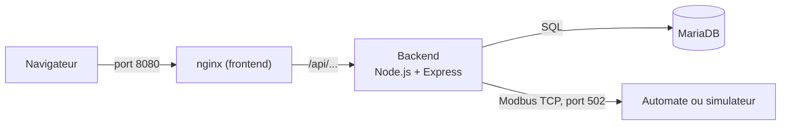
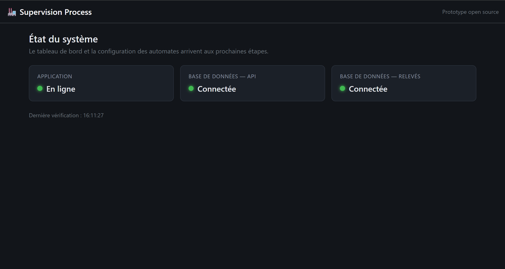
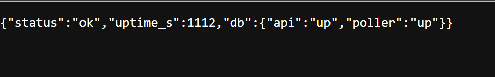

# Développement d’une Solution de Relevé de Données Process

Dans un environnement industriel de plus en plus connecté, disposer d’outils capables de récupérer et d’exploiter les
données des process est devenu essentiel pour surveiller en temps réel, prévenir les pannes, optimiser la
consommation énergétique, et maintenir les standards de qualité. Ces données contribuent ainsi à une meilleure
performance globale et à la réduction des coûts.

Cependant, les outils de supervision actuels, souvent basés sur des technologies propriétaires, présentent plusieurs
inconvénients :

- Coût élevé : Des licences et matériels onéreux qui impactent les budgets d’investissement.
- Dépendance aux fournisseurs externes : Un manque d’autonomie pour ajuster et personnaliser les outils en
fonction des besoins spécifiques.
- Rigidité : Des systèmes peu flexibles, limitant leur adaptabilité aux évolutions rapides des besoins.
  
# Enjeux & Défis

Ce projet vise à créer une solution de suivi indépendante et flexible, permettant aux industriels de surveiller leurs
process en toute autonomie et à moindre coût, tout en répondant à différents besoins. Cette solution permettrait :
- Une indépendance technologique : S’affranchir des solutions propriétaires pour éviter les coûts de licence et
gagner en autonomie.
- Adaptabilité et déploiement rapide : Mettre en place les outils de suivi efficacement, notamment en cas de
besoin urgent de visibilité sur les données.
- Flexibilité et modularité : Adapter les systèmes de suivi aux besoins spécifiques de chaque installation.

En s’appuyant sur des technologies open source, cette solution offre aux industriels un contrôle total sur leur suivi de
données sans dépendance vis-à-vis de fournisseurs tiers. Elle est conçue pour être facilement déployable, modulable,
et paramétrable afin que les techniciens puissent définir eux-mêmes les automates et variables à surveiller. Plus qu’une
simple solution technique, il s’agit de développer un outil stratégique pour l’industrie, qui répond aux exigences
d’autonomie et de résilience tout en restant accessible financièrement

# Description de l’application

Votre mission est de concevoir un prototype de solution de suivi modulaire et portable, pensé pour s’adapter à divers
environnements industriels. Cette application open source doit fournir aux industriels un outil de suivi indépendant et
flexible, capable de surveiller en temps réel les variables critiques d’automates (par exemple, température, pression).
Elle doit permettre aux utilisateurs de configurer facilement les adresses IP des automates et les variables à surveiller
via une interface intuitive. Les données collectées seront affichées sur un tableau de bord interactif pour faciliter
l’analyse et la prise de décision. Pensée pour un déploiement rapide sur un réseau local, cette application représente
une alternative aux solutions propriétaires, offrant une autonomie totale tout en minimisant les coûts.

# Objectifs de l'application

1. Paramétrage des variables : Une interface simple pour configurer les paramètres des automates et définir les
variables à surveiller.
2. Supervision en temps réel : Un tableau de bord clair et interactif pour visualiser les variables monitorées.
3. Utilisation de solutions open source : Un développement basé sur des technologies libres pour garantir
indépendance et maîtrise des coûts.
4. Déploiement rapide : Une architecture permettant une installation en quelques minutes, adaptée aux besoins
urgents de supervision.

# Parcours utilisateur envisagé
Le parcours utilisateur met en lumière les fonctionnalités clés auxquelles les techniciens ou ingénieurs auront accès
pour surveiller et exploiter les données en temps réel et historique.

1. Accès à l’application : L’application est accessible via un navigateur sur le réseau local de l’entreprise.
L’utilisateur (technicien, ingénieur, etc.) peut accéder aux fonctionnalités de configuration et de supervision.
2. Configuration des paramètres : L’utilisateur peut ajouter ou modifier les paramètres des variables à surveiller.
Pour chaque variable, il peut définir le nom, l’adresse IP de l’automate, la variable à lire, et la fréquence
d’enregistrement. Ces paramètres sont sauvegardés dans la base de données pour être utilisés par le backend.
3. Supervision en temps réel : Pour chaque variable surveillée, un tableau de bord affiche les données en temps
réel sous forme de graphiques. Ce graphique se met à jour automatiquement en fonction de la fréquence
d’enregistrement configurée. Cette interface simple permet à l’utilisateur d’interpréter les résultats
rapidement sans autre logiciel spécifique.
4. Consultation des données historiques : Les données des variables surveillées peuvent être exportées via une
interface dotée d’un formulaire permettant de définir une plage de dates. L’export se fait au format CSV, afin
de faciliter leur exploitation dans d’autres outils spécifiques ou leur partage avec d’autres équipes.

# Parcours Backend envisagé

Le parcours backend détaille les processus invisibles qui orchestrent la récupération des données des automates, leur
stockage et leur mise à disposition pour le frontend.

1. Initialisation et Chargement des Paramètres : Au démarrage, le backend se connecte à la base de données
pour récupérer la liste des variables à surveiller (IP des automates, registres à lire, fréquence, etc.). Il initialise
les tâches périodiques de supervision en fonction des paramètres configurés.
2. Surveillance et Lecture des Automates : Le backend lit et les variables automate à surveiller, à intervalles
réguliers, en fonction de la fréquence définie pour chaque variable dans la base de données. Il gère les
connexions Modbus et gère les erreurs en cas de défaillance de connexion ou de lecture.
3. Enregistrement des Données en Base : Après chaque lecture, les valeurs récupérées sont sauvegardées dans
la base de données, avec un horodatage. Cette historisation permet la consultation et l’export des données par
les utilisateurs.
4. API REST pour le Frontend : Le backend expose des routes pour permettre au frontend de notamment :
o Ajouter, modifier ou supprimer des paramètres de surveillance.
o Afficher les valeurs de la variable surveillée pour interprétation sous graphique depuis le frontend.
o Récupérer les données historiques pour une période donnée et les mettre à disposition en
téléchargement via un fichier CSV.
5. Gestion des Tâches Périodiques : Le backend surveille en continu les variables configurées grâce à des tâches
périodiques (par exemple, avec node-cron ou un équivalent). Ces tâches s'adaptent dynamiquement : si des
modifications sont apportées dans la configuration (par exemple, ajout d'une nouvelle variable), elles sont
prises en compte sans nécessiter de redémarrage du serveur.
6. Déploiement et Accessibilité : Le backend est déployé dans un conteneur Docker et configuré pour écouter
sur un port spécifique. Il est accessible depuis d’autres machines du réseau pour communiquer avec le frontend
ou d’autres services.

---

## Relevé de données process

Cette application relève périodiquement des valeurs (température, pression…) sur des automates Modbus TCP, les enregistre avec leur horodatage dans MariaDB et les expose par une API.

Au jalon 2, le relevé et l'API de configuration fonctionnent. Les graphiques temps réel (J3) et l'export CSV (J4) ne sont pas encore faits.

## Schéma



## Lancer le projet

Prérequis : Docker Desktop (avec WSL2 sous Windows), ou Docker Engine + Docker Compose v2.

```bash
cp .env.example .env          # sous PowerShell : Copy-Item .env.example .env ; remplacer les mots de passe
docker compose up -d --build
```

Puis ouvrir http://localhost:8080 (page d'accueil) ou http://localhost:3000/api/health (état de l'API et de la base).

Au premier démarrage, la base est créée avec un automate « Simulateur » et quatre variables de démonstration. Pour repartir de zéro : `docker compose down -v` (cela efface les données).

## Utiliser l'application

Il n'y a pas encore d'écran de configuration : on passe par l'API, par exemple avec `curl` (Git Bash ou WSL).

1. Voir les automates : `curl http://localhost:3000/api/plcs`
2. Ajouter une variable (ici, la température du simulateur, registre 0) :

```bash
curl -X POST http://localhost:3000/api/variables \
  -H "Content-Type: application/json" \
  -d '{"plc_id":1,"name":"Température test","register_type":"holding","address":0,"data_type":"int16","scale":0.1,"frequency_s":2,"unit":"°C"}'
```

3. Vérifier que le relevé tourne : `curl http://localhost:3000/api/plcs/status`

Les mesures sont écrites dans la table `prod.measures`. Les lire via l'API arrivera avec le jalon 3.

### Routes

| Méthode | Route | Rôle |
|---|---|---|
| GET, POST | `/api/plcs` | Lister / ajouter un automate |
| GET, PUT, DELETE | `/api/plcs/:id` | Voir / modifier / supprimer un automate (refusé s'il a des variables) |
| GET | `/api/plcs/status` | État de connexion de chaque automate |
| GET, POST | `/api/variables` | Lister (filtre `?plc_id=`) / ajouter une variable |
| GET, PUT, DELETE | `/api/variables/:id` | Voir / modifier / supprimer une variable (suppression logique) |

L'état renvoyé par `/api/plcs/status` :

| `state` | Signification |
|---|---|
| `online` | La dernière lecture a réussi |
| `offline` | La dernière lecture a échoué (`last_error` donne la cause, par ex. `ECONNREFUSED`) |
| `unknown` | Aucune lecture encore tentée (ou automate désactivé) |

## Simulateur et vrai automate

Le conteneur `simulator` joue un automate Modbus TCP. Il n'est pas publié sur le réseau : seul le backend le joint, sur le port 5020, unit ID 1.

| Registre (holding) | Grandeur | Échelle |
|---|---|---|
| 0 | Température (°C) | × 0,1 |
| 1 | Pression (bar) | × 0,01 |
| 2 | Débit (m³/h) | × 0,1 |
| 3 | Niveau (%) | × 0,1 |

Pour brancher un vrai automate, il suffit de changer son adresse : `PUT /api/plcs/1` avec le nouveau `host`, `port` et `unit_id`. Les variables restent à régler : leurs adresses de registres doivent correspondre à la carte de ce nouvel automate.

## Comment le relevé fonctionne

- **Une tâche par variable**, avec `setInterval`. Nous n'avons pas utilisé `node-cron` : il travaille à la minute sur des horaires fixes, alors que nous voulions des fréquences en secondes (2 s, 7 s…). Quand une variable est ajoutée, modifiée ou supprimée, le relevé est replanifié à chaud, sans redémarrer le serveur.
- **Une connexion Modbus par automate.** Les lectures d'un même automate se font l'une après l'autre. Une variable encore en cours de lecture saute son tour. Un automate lent ne bloque pas les autres.
- **Délai de lecture** : `MODBUS_TIMEOUT_MS` (3000 par défaut). Passé ce délai, la lecture échoue.
- **Échec** : une mesure est tout de même enregistrée, avec `quality = bad` et une valeur vide. Une coupure apparaît donc dans l'historique.
- **Lecture seule** : seules les fonctions Modbus 1 à 4 (lecture) sont utilisées. Le compte SQL `poller` ne peut qu'ajouter des mesures, et le compte `api` ne peut que les lire. Aucune route ne modifie les mesures.

## Accès depuis un autre PC du réseau

Remplacer `localhost` par l'adresse IP de la machine qui fait tourner Docker (commande `ipconfig`). Il faut aussi autoriser les ports 8080 et 3000 dans le pare-feu Windows, et passer le réseau en profil « Privé ». Ce point n'est pas encore testé de notre côté.

## Limites connues

- **Pas d'authentification sur l'API** avant le jalon 5. Le port 3000 est publié car le sujet l'exige : toute personne du réseau peut donc modifier la configuration.
- **Pendant une panne, les mesures en échec s'espacent.** Les lectures d'un même automate se font l'une après l'autre. Si l'automate ne répond pas du tout, chaque échec attend le délai de 3 s : avec quatre variables, les mesures en échec arrivent alors moins souvent que la fréquence configurée.
- **Pas encore faits** : graphiques temps réel (J3), export CSV (J4), comptes et équipes (J5), tableau de bord configurable (J6).

## Aperçu

La page d'accueil affiche l'état de l'application et des deux connexions à la base de données. Elle se met à jour toutes les 5 secondes.



Si la base de données s'arrête (`docker compose stop db`), l'application reste en ligne et signale le problème. Tout revient au vert quand la base redémarre.


La même information est disponible en JSON sur `http://localhost:3000/api/health` :



## Rapport technique

Le détail (choix techniques, modèle de données, difficultés) est dans [docs/RAPPORT.md](docs/RAPPORT.md).
