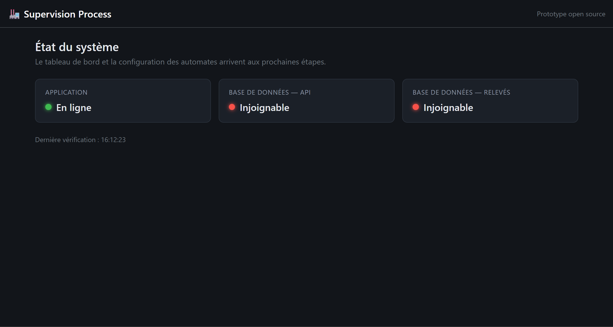

# Développement d’une Solution de Relevé de Données Process

Dans un environnement industriel de plus en plus connecté, disposer d’outils capables de récupérer et d’exploiter les
données des process est devenu essentiel pour surveiller en temps réel, prévenir les pannes, optimiser la
consommation énergétique, et maintenir les standards de qualité. Ces données contribuent ainsi à une meilleure
performance globale et à la réduction des coûts.

Cependant, les outils de supervision actuels, souvent basés sur des technologies propriétaires, présentent plusieurs
inconvénients :

- Coût élevé : Des licences et matériels onéreux qui impactent les budgets d’investissement.
- Dépendance aux fournisseurs externes : Un manque d’autonomie pour ajuster et personnaliser les outils en
fonction des besoins spécifiques.
- Rigidité : Des systèmes peu flexibles, limitant leur adaptabilité aux évolutions rapides des besoins.
  
# Enjeux & Défis

Ce projet vise à créer une solution de suivi indépendante et flexible, permettant aux industriels de surveiller leurs
process en toute autonomie et à moindre coût, tout en répondant à différents besoins. Cette solution permettrait :
- Une indépendance technologique : S’affranchir des solutions propriétaires pour éviter les coûts de licence et
gagner en autonomie.
- Adaptabilité et déploiement rapide : Mettre en place les outils de suivi efficacement, notamment en cas de
besoin urgent de visibilité sur les données.
- Flexibilité et modularité : Adapter les systèmes de suivi aux besoins spécifiques de chaque installation.

En s’appuyant sur des technologies open source, cette solution offre aux industriels un contrôle total sur leur suivi de
données sans dépendance vis-à-vis de fournisseurs tiers. Elle est conçue pour être facilement déployable, modulable,
et paramétrable afin que les techniciens puissent définir eux-mêmes les automates et variables à surveiller. Plus qu’une
simple solution technique, il s’agit de développer un outil stratégique pour l’industrie, qui répond aux exigences
d’autonomie et de résilience tout en restant accessible financièrement

# Description de l’application

Votre mission est de concevoir un prototype de solution de suivi modulaire et portable, pensé pour s’adapter à divers
environnements industriels. Cette application open source doit fournir aux industriels un outil de suivi indépendant et
flexible, capable de surveiller en temps réel les variables critiques d’automates (par exemple, température, pression).
Elle doit permettre aux utilisateurs de configurer facilement les adresses IP des automates et les variables à surveiller
via une interface intuitive. Les données collectées seront affichées sur un tableau de bord interactif pour faciliter
l’analyse et la prise de décision. Pensée pour un déploiement rapide sur un réseau local, cette application représente
une alternative aux solutions propriétaires, offrant une autonomie totale tout en minimisant les coûts.

# Objectifs de l'application

1. Paramétrage des variables : Une interface simple pour configurer les paramètres des automates et définir les
variables à surveiller.
2. Supervision en temps réel : Un tableau de bord clair et interactif pour visualiser les variables monitorées.
3. Utilisation de solutions open source : Un développement basé sur des technologies libres pour garantir
indépendance et maîtrise des coûts.
4. Déploiement rapide : Une architecture permettant une installation en quelques minutes, adaptée aux besoins
urgents de supervision.

# Parcours utilisateur envisagé
Le parcours utilisateur met en lumière les fonctionnalités clés auxquelles les techniciens ou ingénieurs auront accès
pour surveiller et exploiter les données en temps réel et historique.

1. Accès à l’application : L’application est accessible via un navigateur sur le réseau local de l’entreprise.
L’utilisateur (technicien, ingénieur, etc.) peut accéder aux fonctionnalités de configuration et de supervision.
2. Configuration des paramètres : L’utilisateur peut ajouter ou modifier les paramètres des variables à surveiller.
Pour chaque variable, il peut définir le nom, l’adresse IP de l’automate, la variable à lire, et la fréquence
d’enregistrement. Ces paramètres sont sauvegardés dans la base de données pour être utilisés par le backend.
3. Supervision en temps réel : Pour chaque variable surveillée, un tableau de bord affiche les données en temps
réel sous forme de graphiques. Ce graphique se met à jour automatiquement en fonction de la fréquence
d’enregistrement configurée. Cette interface simple permet à l’utilisateur d’interpréter les résultats
rapidement sans autre logiciel spécifique.
4. Consultation des données historiques : Les données des variables surveillées peuvent être exportées via une
interface dotée d’un formulaire permettant de définir une plage de dates. L’export se fait au format CSV, afin
de faciliter leur exploitation dans d’autres outils spécifiques ou leur partage avec d’autres équipes.

# Parcours Backend envisagé

Le parcours backend détaille les processus invisibles qui orchestrent la récupération des données des automates, leur
stockage et leur mise à disposition pour le frontend.

1. Initialisation et Chargement des Paramètres : Au démarrage, le backend se connecte à la base de données
pour récupérer la liste des variables à surveiller (IP des automates, registres à lire, fréquence, etc.). Il initialise
les tâches périodiques de supervision en fonction des paramètres configurés.
2. Surveillance et Lecture des Automates : Le backend lit et les variables automate à surveiller, à intervalles
réguliers, en fonction de la fréquence définie pour chaque variable dans la base de données. Il gère les
connexions Modbus et gère les erreurs en cas de défaillance de connexion ou de lecture.
3. Enregistrement des Données en Base : Après chaque lecture, les valeurs récupérées sont sauvegardées dans
la base de données, avec un horodatage. Cette historisation permet la consultation et l’export des données par
les utilisateurs.
4. API REST pour le Frontend : Le backend expose des routes pour permettre au frontend de notamment :
o Ajouter, modifier ou supprimer des paramètres de surveillance.
o Afficher les valeurs de la variable surveillée pour interprétation sous graphique depuis le frontend.
o Récupérer les données historiques pour une période donnée et les mettre à disposition en
téléchargement via un fichier CSV.
5. Gestion des Tâches Périodiques : Le backend surveille en continu les variables configurées grâce à des tâches
périodiques (par exemple, avec node-cron ou un équivalent). Ces tâches s'adaptent dynamiquement : si des
modifications sont apportées dans la configuration (par exemple, ajout d'une nouvelle variable), elles sont
prises en compte sans nécessiter de redémarrage du serveur.
6. Déploiement et Accessibilité : Le backend est déployé dans un conteneur Docker et configuré pour écouter
sur un port spécifique. Il est accessible depuis d’autres machines du réseau pour communiquer avec le frontend
ou d’autres services.

# Démarrage rapide

**Prérequis :** Docker Desktop (avec WSL2 sous Windows) ou Docker Engine + Docker Compose v2.

```bash
cp .env.example .env          # puis remplacer les mots de passe
docker compose up -d --build
```

| Service | URL |
|---|---|
| Application | http://localhost:8080 |
| API (santé) | http://localhost:3000/api/health |

La base MariaDB n'est pas exposée hors du réseau Docker. Au premier démarrage, elle crée les schémas `config`, `prod` et `app`, les comptes SQL `api` et `poller` et des données de démonstration (`db/init/`).

**Accès depuis un autre poste du réseau local :** remplacer `localhost` par l'adresse IP de la machine hôte (`ipconfig` sous Windows). Sous Windows, autoriser les ports 8080 et 3000 en entrée dans le pare-feu.

**Réinitialiser la base** (efface toutes les données) : `docker compose down -v`.

# Aperçu

La page d'accueil affiche l'état de l'application et des deux connexions à la base de données. Elle se met à jour toutes les 5 secondes.


Si la base de données s'arrête (`docker compose stop db`), l'application reste en ligne et signale le problème. Tout revient au vert quand la base redémarre.



La même information est disponible en JSON sur `http://localhost:3000/api/health` :


Rapport technique : [docs/RAPPORT.md](docs/RAPPORT.md).
