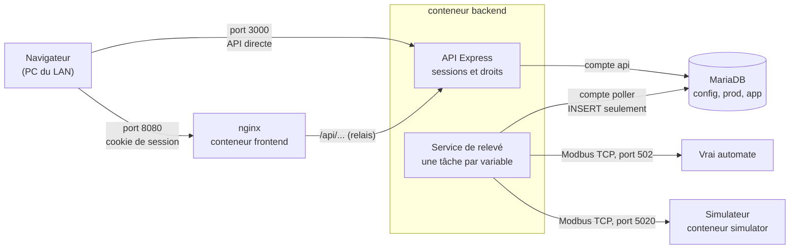
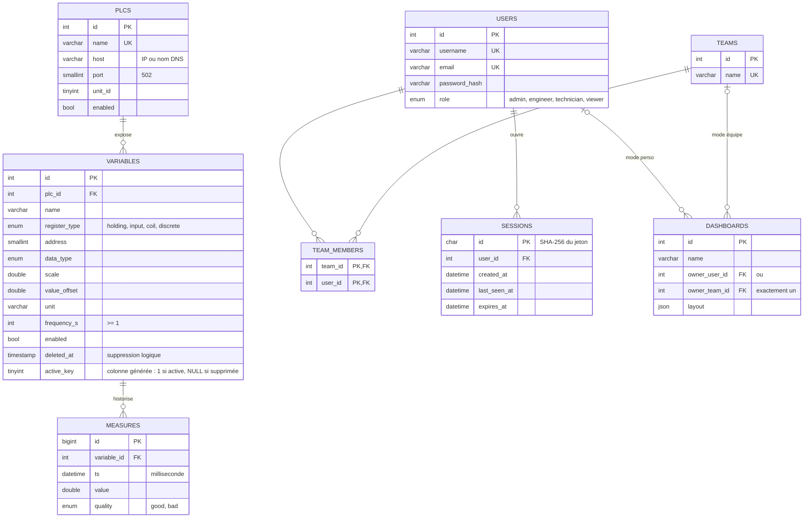
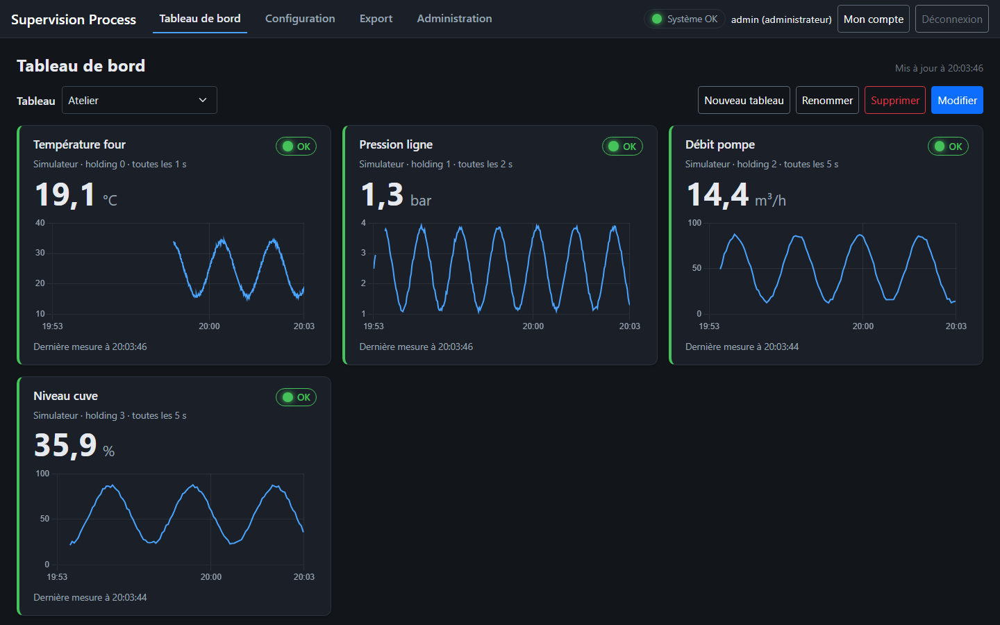

# Relevé de données process : outil de supervision d'automates

**Rapport de TP : Développement d'une solution de relevé de données process**

- **Nom d'équipe :** <!-- À COMPLÉTER : nom d'équipe, s'il y en a un -->
- **Membres :** LASFER Amine & JOLY Quentin
- **Formation :** I5 FISA PAUC
- **Année :** 2026/2027
- **Date :** <!-- À COMPLÉTER : date de rendu (08/12/2026 prévu) -->

<!-- saut de page -->

## 1. Contexte et objectif

Les outils de supervision industrielle, ces écrans qui montrent en direct l'état d'une machine, sont souvent vendus sous licence et livrés avec du matériel dédié. Pour une petite équipe de maintenance, le coût et la rigidité de ces logiciels posent problème : il est difficile de les adapter à un besoin précis.

Le sujet demande donc un prototype de supervision open source, qui tourne sur le réseau local de l'entreprise. Un **automate** (en anglais PLC) est un petit calculateur industriel qui pilote une machine et mesure des grandeurs comme la température ou la pression. Ces grandeurs sont rangées dans des **registres**, des cases numérotées qu'un logiciel extérieur peut lire. Le protocole **Modbus TCP** est la méthode standard pour lire ces registres à travers le réseau.

Notre application doit permettre de :

- configurer les adresses des automates et les variables à surveiller, depuis une page web ;
- afficher les valeurs en temps réel sous forme de graphiques ;
- exporter les mesures d'une plage de dates au format CSV ;
- installer l'ensemble rapidement, grâce à Docker.

Le sujet ne demandait que ce socle. Nous avons choisi d'ajouter ensuite les comptes et les rôles, les équipes, puis un tableau de bord configurable, en gardant comme priorité une démonstration qui fonctionne à chaque essai.

Au moment de la rédaction (19/11/2026), les jalons J1 à J6 sont livrés. Ils ont été testés dans Docker et dans un navigateur sans fenêtre. Les tests sur un vrai automate et depuis un autre poste du réseau restent à faire (section 5.3).

## 2. Liens

- **Dépôt GitHub :** https://github.com/TiTooom/TP_SI_2027_Outil_Industriel
- **Mode d'emploi :** le fichier [README.md](../README.md) du dépôt (lancement, utilisation, branchement d'un automate).
- **Vidéo de démonstration :** <!-- À COMPLÉTER : lien de la vidéo, à ajouter avant le 08/12 -->

## 3. Architecture technique

### 3.1 Schéma de fonctionnement

Le navigateur ne parle jamais directement à la base de données. Toutes les demandes passent par nginx, puis par le backend. Le backend contient aussi le **service de relevé** : une tâche qui interroge les automates à intervalles réguliers et écrit les mesures dans la base.

### 3.2 Rôle de chaque conteneur

Un **conteneur** Docker est une petite boîte isolée qui contient un programme et tout ce dont il a besoin. Le projet en compte quatre, décrits dans un seul fichier, `docker-compose.yml`, à la racine.

| Conteneur | Image | Rôle | Port |
|---|---|---|---|
| `db` | `mariadb:11.4` (image standard) | Stocke la configuration, les mesures, les comptes et les sessions | Aucun : réseau interne |
| `backend` | Notre `Dockerfile`, base `node:22.21.1-alpine3.22` | API, relevé Modbus, connexion, droits | 3000, publié sur le LAN |
| `frontend` | `nginx:1.27-alpine` (image standard) | Sert les pages HTML, CSS, JS et transmet `/api` au backend | 8080, publié sur le LAN |
| `simulator` | Notre `Dockerfile`, base `node:22.21.1-alpine3.22` | Automate Modbus factice : température, pression, débit, niveau | 5020, interne seulement |

Le backend attend que la base soit prête (contrôle de santé « healthy ») avant de démarrer. Le simulateur ne bloque pas le backend : si l'automate factice tombe, l'application continue de tourner. Pour brancher un vrai automate, il suffit de changer son adresse dans la configuration.

### 3.3 Connexion et sécurité

- **Mot de passe** : haché avec scrypt, un algorithme intégré à Node.js, qui ne demande aucune compilation sous Alpine. Il doit faire au moins 10 caractères.
- **Session** : à la connexion, le serveur crée un jeton aléatoire de 256 bits, envoyé dans un cookie `HttpOnly` et `SameSite=Strict` (le JavaScript de la page ne peut pas le lire). La base ne garde que son empreinte SHA-256. La session expire après 8 h sans activité, ou 24 h au maximum.
- **Anti brute-force** : 5 échecs pour un couple (adresse IP, nom), 20 échecs pour un même nom, ou 30 pour une même adresse IP, bloquent la connexion pendant 15 minutes.
- **Droits** : le backend vérifie le rôle à chaque route. Les boutons masqués dans la page ne sont qu'un confort ; la vraie barrière est côté serveur.
- **Requêtes** : toutes les requêtes SQL sont paramétrées, et nginx envoie une politique de contenu (CSP) qui limite les scripts autorisés.

### 3.4 Choix des technologies

| Technologie | Rôle dans le projet | Pourquoi ce choix |
|---|---|---|
| HTML, CSS, JavaScript | Pages de l'interface | Imposés par le sujet. Pas de framework (React, Vue) : les fichiers sont servis tels quels, sans compilation. |
| Node.js et Express | Backend : routes qui répondent à des adresses web (une « API REST ») | Le même langage des deux côtés. Express est simple et très répandu. |
| modbus-serial | Lecture des automates en Modbus TCP (la bibliothèque notée « Modul Serial » dans le sujet) | Elle couvre les fonctions de lecture 1 à 4. L'application ne l'utilise jamais pour écrire. |
| mysql2 | Pilote qui relie Node.js à MariaDB | Requêtes paramétrées, et un pool de connexions par compte SQL. |
| MariaDB | Base de données SQL | Base libre. Elle gère les schémas, les clés étrangères, les contraintes `CHECK` et le type JSON. |
| nginx | Serveur web et relais | Le navigateur ne voit qu'une seule adresse, donc pas de problème CORS. nginx retrouve le backend après un redémarrage. |
| Bootstrap 5.3.3, Chart.js 4.4.7 | Mise en forme et graphiques | Copiés dans le projet : le réseau d'une usine n'a pas forcément accès à Internet. |
| dotenv | Lecture du fichier `.env` | Les mots de passe ne sont jamais écrits dans le code ni publiés sur GitHub. |
| Docker Compose | Lancement des quatre services | Une seule commande, le même environnement sur chaque poste. Sous Windows, Docker Desktop passe par WSL2. |
| nodemon | Relance automatique pendant le développement | Déclaré pour le développement seulement : il n'est pas dans l'image de production. |

### 3.5 Écarts avec le sujet

Deux bibliothèques du sujet ne sont pas utilisées, pour des raisons techniques.

- **node-cron est remplacé par `setInterval`.** node-cron planifie à la minute, avec des motifs comme `*/5 * * * *`. Nos fréquences sont en secondes, et elles varient d'une variable à l'autre. Nous créons un minuteur par variable. Quand une variable change, son minuteur est remplacé : aucun redémarrage n'est nécessaire.
- **export-to-csv est remplacé par un générateur maison.** Cette bibliothèque construit le fichier entier en mémoire. Avec 500 000 lignes, cela aurait saturé le serveur. Notre générateur produit le CSV par blocs, au fur et à mesure de la lecture dans la base.

## 4. Modèle relationnel

Les données sont rangées dans **trois schémas**, c'est-à-dire trois espaces séparés dans la même base :

- `config` : ce que l'on surveille (automates et variables) ;
- `prod` : ce qui a été mesuré, avec la date et l'heure ;
- `app` : qui utilise l'outil (comptes, équipes, sessions, tableaux de bord).

Nous avons fait les choix suivants.

- **Les mesures sont en lecture seule pour l'application.** C'est la règle la plus importante. Le compte `api`, utilisé par le site, ne peut que lire `prod`. Le compte `poller`, qui fait le relevé, ne peut qu'ajouter des lignes dans `prod.measures`. Aucun des deux ne peut modifier ni supprimer une mesure. La règle est écrite dans la base : une erreur dans le code de l'API ne pourrait pas effacer l'historique. Nous l'avons vérifiée dans MariaDB.
- **Suppression logique des variables.** La colonne `deleted_at` marque une variable comme supprimée, sans l'effacer. La clé étrangère vers `measures` est en `RESTRICT` : l'historique reste donc consultable et exportable.
- **Nom unique parmi les variables actives.** Une colonne calculée `active_key` vaut 1 tant que la variable n'est pas supprimée. Un nom supprimé peut ainsi être réutilisé.
- **Une lecture en échec est gardée.** La mesure est enregistrée avec `value = NULL` et `quality = 'bad'`. Les coupures apparaissent ainsi dans l'historique et dans l'export.
- **Des contraintes `CHECK`.** La fréquence doit être d'au moins 1 seconde, le port doit être positif, et un tableau de bord appartient soit à un utilisateur, soit à une équipe, jamais aux deux.
- **Des index.** `measures (variable_id, ts)` sert aux graphiques et à l'export par plage de dates. `sessions (user_id)` et `sessions (expires_at)` servent à la connexion et à la purge. Le nom d'un tableau est unique pour chaque propriétaire.
- **Sessions en base.** Une session peut être révoquée à tout moment, par exemple au changement de mot de passe. Les sessions expirées sont supprimées chaque heure.
- **Tableaux de bord en JSON.** La colonne `layout` contient la disposition (version 1, liste de cartes avec leur taille). Un propriétaire garde au plus 20 tableaux, et un tableau contient au plus 50 cartes.
- **Dates en UTC.** La base travaille en UTC. Le fichier CSV ajoute une colonne d'heure locale (fuseau `Europe/Paris`).

**Migrations.** `db/init` ne s'exécute que sur un volume vide. Une base créée avant J5 et J6 reçoit donc à la main `db/migrations/002` (index des tableaux) et `003` (table des sessions), décrits dans le README.

## 5. Fonctionnalités réalisées

### 5.1 Ce qui est livré

| Jalon | Ce qui fonctionne | Comment nous l'avons vérifié |
|---|---|---|
| J1 | Quatre conteneurs, base en trois schémas, comptes SQL à droits minimaux, contraintes `CHECK`, page d'état | Démarrage Docker, droits SQL testés par requêtes, données conservées après redémarrage |
| J2 | Ajout, modification et suppression d'automates et de variables ; relevé périodique ; état « hors ligne » ; simulateur | Tests unitaires du backend (124 à la fin de J6) et du simulateur (2) ; arrêt puis reprise du simulateur dans Docker |
| J3 | Page Configuration ; tableau de bord temps réel avec un graphique par variable | Chrome sans fenêtre : courbes qui avancent, variable ajoutée sans rechargement, automate coupé puis repris |
| J4 | Export CSV par plage de dates, compatible Excel en français (séparateur `;`, virgule décimale) | 450 000 lignes exportées (39 Mo), 4 exports simultanés (le quatrième reçoit une réponse 429), abandons de téléchargement sans fuite |
| J5 | Connexion, quatre rôles, page Administration, équipes, « Mon compte », anti brute-force | Matrice rôles × routes (348 vérifications sur les ports 8080 et 3000), parcours complet dans Chrome |
| J6 | Tableaux personnels ou d'équipe ; cartes déplacées au glisser-déposer ou avec les boutons ▲ ▼ ; trois tailles | Chrome sans fenêtre : 22 contrôles sur 23 (le 23e signalait les 401 attendus de la page de connexion) |

Les 237 vérifications de bout en bout dans Docker viennent du journal de QA du projet. Le code des tests est dans `BACKEND/tests`.

Voici le tableau de bord temps réel : une carte et un graphique par variable.

### 5.2 Ce qui n'est pas fait

- **Un vrai automate.** Nous avons testé l'application uniquement avec le simulateur, qui parle le même protocole Modbus TCP.
- **L'accès depuis un autre poste.** Nous avons vérifié l'accès par l'adresse IP de la machine hôte, pas depuis un autre PC. Le pare-feu Windows reste à régler.
- **Les écritures vers l'automate, les alertes (seuils, courriels) et le HTTPS.** Les écritures sont exclues volontairement. Les alertes ne faisaient pas partie du socle. Le HTTPS est en limite ci-dessous.

### 5.3 Limites connues

- **Pas de HTTPS.** Le site tourne en HTTP sur le réseau local. Le mot de passe et le cookie de session circulent en clair : une personne du réseau qui écoute le trafic peut récupérer une session. Le cookie n'a pas l'attribut `Secure`, sans quoi il ne passerait pas en HTTP.
- **Verrouillage de compte.** Vingt échecs sur un même nom bloquent ce nom pendant 15 minutes, pour tout le monde. Un tiers du réseau peut donc bloquer le compte administrateur. Le compteur repart à zéro au redémarrage du backend.
- **Port 3000 publié.** L'API est joignable directement, sans passer par nginx. Toutes les routes exigent une session, mais le port reste exposé. En accès direct, l'en-tête `X-Forwarded-For` peut être falsifié : le compteur par adresse IP devient alors peu fiable, seul le compteur par nom reste efficace.
- **Ordre des mots 32 bits.** Seul l'ordre ABCD est lu correctement. Un automate qui envoie les mots en CDAB donne des valeurs fausses. Le contournement consiste à lire chaque registre dans une variable `uint16`.
- **Mesures espacées pendant une panne.** Quand un automate ne répond plus, chaque lecture attend le délai de 3 secondes (`MODBUS_TIMEOUT_MS`). L'état « hors ligne » reste visible.
- **Tests non faits.** Pas de test sur un vrai automate, depuis un autre poste du réseau, sur Firefox ou sur tablette. Le glisser-déposer a été vérifié avec des événements simulés, pas avec une vraie souris. L'ouverture du CSV dans Excel français n'a pas été vérifiée.

## 6. Conclusion et retour d'expérience

### 6.1 Difficultés rencontrées

- **Docker et WSL2.** Ni Docker ni WSL2 n'étaient installés au départ. L'installation a demandé du temps et un redémarrage. <!-- À COMPLÉTER : durée réelle et difficultés sur votre poste -->
- **Initialisation de la base.** Les comptes SQL ne sont créés qu'au premier démarrage. Modifier un droit ou un mot de passe demande de recréer le volume (qui efface les données) ou une migration à la main. Nous avons écrit ce script en shell pour lire les mots de passe depuis l'environnement.
- **Fins de ligne.** Les fichiers écrits sous Windows se terminent par CRLF, que le shell Linux du conteneur ne lit pas. Le fichier `.gitattributes` impose LF pour les scripts, le SQL, les Dockerfile et nginx.

<!-- À COMPLÉTER : autre difficulté marquante de votre binôme, si elle existe -->

### 6.2 Ce que nous avons appris

Le premier jalon nous a appris à découper le projet en services indépendants. Une règle de sécurité, comme l'interdiction de modifier les mesures, est bien plus solide quand la base la fait respecter, et non seulement le code. Enfin, un test lancé dans un vrai conteneur ou dans un vrai navigateur vaut mieux qu'une relecture : plusieurs points n'ont été validés qu'ainsi.

<!-- À COMPLÉTER : ce que vous avez appris personnellement sur le travail en binôme et sur les outils -->

### 6.3 Ce que nous ferions autrement

Nous aurions dû tester plus tôt l'accès depuis un autre poste : c'est le point le plus important pour la démonstration, et nous l'avons repoussé à la fin. Nous aurions aussi prévu une migration de base dès la première version des tables, pour ne pas avoir à recréer le volume.

<!-- À COMPLÉTER : votre ressenti personnel, en 3 à 5 phrases, sur ce qui vous a le plus surpris ou gêné -->
