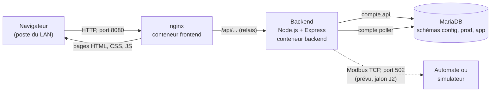
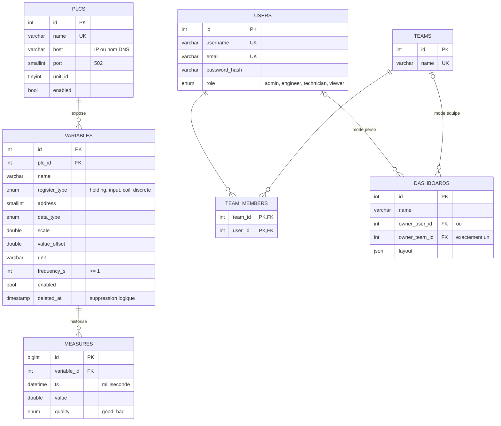

# Relevé de données process : outil de supervision d'automates

**Rapport de TP — Développement d'une solution de relevé de données process**

- **Membres :** LASFER Amine & JOLY Quentin
- **Formation :** I5 FISA PAUC
- **Année :** 2026/2027
- **Date :** à determiner 

<!-- saut de page -->

## 1. Contexte et objectif

Les outils de supervision industrielle, ces écrans qui montrent en direct l'état d'une machine, sont souvent vendus sous licence et livrés avec du matériel dédié. Pour une petite équipe de maintenance, le coût et la rigidité de ces logiciels sont un vrai problème : il est difficile de les adapter à un besoin précis.

Le sujet demande donc un prototype de supervision open source, qui tourne sur le réseau local de l'entreprise et qui permet de :

- configurer les adresses IP des automates et les variables à surveiller, depuis une page web ;
- afficher les valeurs en temps réel sous forme de graphiques ;
- exporter les mesures d'une plage de dates au format CSV ;
- installer l'ensemble rapidement, grâce à Docker.

Un **automate** (en anglais PLC, *programmable logic controller*) est un petit calculateur industriel qui pilote une machine et mesure des grandeurs comme la température ou la pression. Ces grandeurs sont rangées dans des **registres**, des cases numérotées qu'un logiciel extérieur peut lire. Le protocole **Modbus TCP** est la méthode standard pour lire ces registres à travers le réseau.

Ce que nous devions réaliser : le socle demandé par le sujet (gestion des variables, lecture périodique, historique horodaté, graphiques, export CSV, tout dans Docker). Les comptes utilisateurs, les équipes et le tableau de bord configurable viennent ensuite, seulement si le socle fonctionne parfaitement en démonstration. C'est notre priorité : une démo qui marche à chaque essai.

Au moment de la rédaction (19/11/2026), seul le premier jalon, celui des fondations, est terminé. La suite de ce rapport distingue clairement ce qui fonctionne de ce qui est prévu.

## 2. Liens

- Dépôt GitHub : https://github.com/TiTooom/TP_SI_2027_Outil_Industriel
- Vidéo de démonstration : <!-- À COMPLÉTER : lien de la vidéo, à ajouter avant le 08/12 -->

## 3. Architecture technique

### 3.1 Schéma de fonctionnement

Le navigateur ne parle jamais directement à la base de données. Toutes les demandes passent par le serveur web nginx, puis par le backend, qui est le seul à lire et écrire dans MariaDB.

Le trait en pointillés signale ce qui n'est pas encore construit : la lecture Modbus des automates arrive au jalon J2.

### 3.2 Rôle de chaque conteneur

Un **conteneur** Docker est une petite boîte isolée qui contient un programme et tout ce dont il a besoin pour tourner. Notre projet en compte trois, décrits dans un seul fichier, `docker-compose.yml`, à la racine.

| Conteneur | Image utilisée | Rôle | Port |
|---|---|---|---|
| `db` | `mariadb:11.4` (image standard) | Stocke la configuration, les mesures et les comptes | Aucun : réseau interne seulement |
| `backend` | Image construite à partir de notre `Dockerfile` (base `node:22-alpine`) | API Express, lecture des automates (J2), contrôle de l'état | 3000, publié sur le réseau local |
| `frontend` | `nginx:1.27-alpine` (image standard) | Sert les pages HTML, CSS, JS et transmet les appels `/api` au backend | 8080, publié sur le réseau local |

L'ordre de démarrage est important : le backend attend que la base réponde (contrôle de santé « healthy »), puis nginx démarre. Le simulateur d'automate, prévu au jalon J2, s'ajoutera comme un quatrième conteneur. Remplacer le simulateur par un vrai automate ne demandera que de changer l'adresse de l'automate dans la configuration.

Un point de sécurité reste ouvert. Le sujet demande que le backend soit accessible depuis le réseau, donc le port 3000 est aussi publié directement. Une personne du réseau peut donc appeler l'API sans passer par nginx. Pour cette raison, les routes de modification devront être protégées côté serveur au jalon J5.

### 3.3 Choix des technologies

| Technologie | Rôle dans le projet | Pourquoi ce choix |
|---|---|---|
| HTML, CSS, JavaScript | Pages de l'interface | Imposés par le sujet. Nous n'utilisons pas de framework lourd (React, Vue) : les fichiers sont servis tels quels, sans étape de compilation. |
| Node.js et Express | Backend : routes qui répondent à des adresses web (une « API REST ») | Le même langage (JavaScript) côté serveur et côté navigateur. Express est simple et très répandu. |
| MariaDB | Base de données SQL | Base libre, proche de MySQL. Elle gère les schémas, les clés étrangères, les contraintes `CHECK` et le type JSON. |
| nginx | Serveur web et relais (« reverse proxy ») | Léger et rapide. Il fait croire au navigateur qu'il n'y a qu'une seule adresse : pas de problème d'autorisation entre sites (CORS). |
| Docker et Docker Compose | Lancement de tout le projet | Une seule commande installe les trois services, avec le même environnement sur chaque poste. Sous Windows, Docker Desktop utilise WSL2, un sous-système Linux intégré à Windows. |
| mysql2 | Pilote qui relie Node.js à MariaDB | Permet des requêtes paramétrées : les valeurs sont séparées du texte SQL, ce qui évite l'injection SQL. |
| dotenv | Lecture du fichier `.env` | Les mots de passe ne sont pas écrits dans le code. Le fichier `.env` n'est pas publié sur GitHub. |
| Bootstrap | Mise en forme de la page | Composants et grille prêts à l'emploi. Les fichiers sont copiés dans le projet, car le réseau d'une usine n'a pas forcément accès à Internet. |
| nodemon | Relance automatique du serveur pendant le développement | Évite de redémarrer Node à la main à chaque modification. |
| modbus-serial, node-cron, Chart.js, export-to-csv | Lecture Modbus (la bibliothèque notée « Modul Serial » dans le sujet), tâches périodiques, graphiques, export CSV | **Pas encore installées.** Elles arrivent aux jalons J2 à J4. |

## 4. Modèle relationnel

Les données sont rangées dans **trois schémas** (des espaces séparés à l'intérieur de la même base) :

- `config` : ce que l'on surveille (automates et variables) ;
- `prod` : ce qui a été mesuré, avec la date et l'heure de chaque mesure ;
- `app` : qui utilise l'outil (comptes, équipes, tableaux de bord).

Le diagramme ci-dessous décrit ces tables. Il est écrit en texte (langage Mermaid) : GitHub le transforme en schéma automatiquement.

Nous avons fait les choix suivants.

- **Trois schémas.** Séparer la configuration, les mesures et les comptes rend le modèle plus lisible. Les droits d'accès se donnent aussi par schéma.
- **Les mesures sont en lecture seule pour l'application.** C'est la règle la plus importante du projet. Le compte `api` (utilisé par le site) ne peut que lire `prod`. Le compte `poller` (le service de relevé) peut seulement ajouter des lignes dans `prod.measures`. Aucun des deux ne peut modifier ni supprimer une mesure. La règle est donc imposée par la base elle-même : même une erreur dans le code de l'API ne peut pas effacer l'historique. Nous l'avons vérifié dans MariaDB (voir section 5).
- **Suppression logique des variables.** Une variable n'est jamais effacée réellement : on remplit la colonne `deleted_at`. La clé étrangère entre `measures` et `variables` est en `RESTRICT`, ce qui bloque la suppression physique tant qu'il existe des mesures. L'historique reste donc consultable.
- **Un index `(variable_id, ts)`.** Il sert aux deux usages principaux : afficher les dernières valeurs d'une variable et exporter une plage de dates. Sans index, chaque requête lirait toute la table, ce qui devient lent quand les relevés s'accumulent.
- **Une lecture en échec est gardée.** Quand un automate ne répond pas, on enregistre `value = NULL` avec `quality = 'bad'` au lieu de ne rien écrire. Les coupures apparaîtront ainsi sur les graphiques.
- **Des contraintes `CHECK`.** La fréquence doit être d'au moins 1 seconde, le port doit être positif, et un tableau de bord doit appartenir soit à un utilisateur, soit à une équipe, jamais aux deux ni à aucun. La base refuse les données incohérentes, même si le code se trompe.
- **Dates en UTC.** La connexion Node.js est réglée en UTC. La conversion en heure locale se fera à l'affichage.
- **Disposition du tableau de bord en JSON.** Les positions des éléments glissés-déposés seront stockées dans une colonne `layout` de type JSON. Cette partie n'est pas encore utilisée.

Les tables `app.*` et `prod.measures` existent, mais l'application ne les remplit pas encore : les comptes et les mesures arrivent aux jalons suivants. Les données de démonstration (un automate « Simulateur » et quatre variables : température, pression, débit, niveau) sont déjà en place.

## 5. Fonctionnalités réalisées

### 5.1 Ce qui est réalisé (jalons J1 à J4)

| Fonctionnalité | État |
|---|---|
| Lancement des trois conteneurs avec une seule commande | Fait, testé |
| Création automatique de la base au premier démarrage (3 schémas, tables, comptes, données de démo) | Fait, testé |
| Droits SQL minimaux pour les comptes `api` et `poller` | Fait, testé |
| Contraintes de cohérence de la base (`CHECK`) | Fait, testé |
| Route `/api/health` : état de l'application et des deux connexions à la base | Fait, testé |
| Page d'accueil « État du système » : trois pastilles mises à jour toutes les 5 secondes | Fait, testé |
| Accès à l'application par nginx (port 8080) et à l'API (port 3000) | Fait, testé depuis la machine hôte |
| Conservation des données après redémarrage (volume Docker) | Fait, testé |
| Port de la base non publié sur le réseau | Fait, vérifié |
| Page « Configuration » : ajouter, modifier et supprimer les automates et les variables depuis le navigateur | Écrit, test de démonstration à faire |
| Tableau de bord temps réel : un graphique Chart.js par variable active, avec l'état de chaque automate | Écrit, test de démonstration à faire |
| Relevé Modbus TCP périodique, avec délai d'attente et nouvelle tentative ; une panne d'automate ne bloque pas le backend (J2) | Écrit, test de démonstration à faire |
| API de configuration des automates et des variables (ajout, modification, suppression logique) (J2) | Écrit, test de démonstration à faire |
| Simulateur Modbus TCP factice dans un conteneur, pour tester sans matériel (J2) | Écrit, test de démonstration à faire |
| Export CSV par plage de dates depuis la page « Export » : séparateur `;`, décimales à la virgule, compatible Excel français, plage limitée à 31 jours et 500 000 lignes (J4) | Écrit. 15 tests automatiques passent (`node --test`). Test de démonstration à faire |

Les tests réellement effectués le 19/11 dans Docker sont les suivants :

- la base s'initialise avec ses trois scripts ;
- les conteneurs `db` et `backend` passent à l'état « healthy » ;
- `/api/health` répond directement et à travers nginx ;
- le compte `api` ne peut ni ajouter ni supprimer une mesure, le compte `poller` ne peut ni modifier ni supprimer de mesure, ni écrire dans la configuration, ni lire le schéma `app` ;
- les contraintes `CHECK` refusent les valeurs interdites ;
- les données restent présentes après un redémarrage.

Trois tests automatiques sont écrits avec le test intégré de Node.js (`npm test` dans le dossier `BACKEND`). Ils vérifient que l'API répond « degraded » avec le code 503 quand la base est absente, qu'une route inconnue renvoie une erreur JSON 404, et qu'un corps JSON mal formé renvoie 400.

Les captures de la page d'accueil (base connectée puis base coupée) sont présentées dans le README du dépôt.

<!-- À COMPLÉTER (J3) : une capture du tableau de bord temps réel, plus parlante pour le rapport (ASSETS/dashboard.png) -->

**Accès depuis un autre poste du réseau.** Pour l'instant, nous n'avons testé l'accès que depuis la machine hôte, en utilisant son adresse IP du réseau local. Le profil réseau Windows était en mode « Public », ce qui bloque les connexions entrantes. Il faut le passer en « Privé » ou adapter la règle du pare-feu pour les ports 8080 et 3000. Ce test reste à faire.

### 5.2 Jalon J5 : comptes, rôles et équipes

Ces fonctionnalités sont écrites. Elles attendent encore leur test de démonstration.

- **Connexion par session** : nom d'utilisateur et mot de passe, puis un cookie de session. La session expire après 8 h sans activité et 24 h au maximum (valeurs réglables dans `.env`).
- **Anti brute-force** : après plusieurs échecs, la connexion est bloquée pendant 15 minutes pour ce couple IP et nom d'utilisateur.
- **Premier administrateur** : créé au démarrage à partir de `ADMIN_USERNAME` et `ADMIN_PASSWORD`, si la base ne contient aucun compte.
- **Mon compte** : chacun peut changer son mot de passe.
- **Quatre rôles** (lecteur, technicien, ingénieur, administrateur), vérifiés par le backend sur chaque route. Les boutons du site sont aussi masqués selon le rôle.
- **Page Administration** (administrateur seul) : créer, supprimer un compte, changer son rôle, réinitialiser son mot de passe.
- **Équipes** : créer, renommer, supprimer une équipe, ajouter ou retirer des membres. Les équipes ne servent pas encore au tableau de bord : ce sera le rôle du jalon J6.
- **API protégée** : toutes les routes de l'API, y compris celles du port 3000 publié sur le réseau, exigent une session, sauf la connexion et `/api/health`.

### 5.3 Ce qui n'est pas encore fait

Les fonctionnalités suivantes sont prévues. Elles ne sont **pas** réalisées à ce jour.

- **Jalon J5 (à venir) :** comptes utilisateurs, connexion, rôles (administrateur, ingénieur, technicien, lecteur) ; équipes ; protection des routes côté serveur.
- **Jalon J6 (à venir) :** tableau de bord configurable par glisser-déposer, en mode personnel ou en mode équipe.

## 6. Conclusion et retour d'expérience

### 6.1 Difficultés rencontrées

- **Installation de Docker et de WSL2.** Au départ, ni Docker ni WSL2 n'étaient installés sur le poste de développement. Docker Desktop s'appuie sur WSL2, et l'installation a demandé du temps et un redémarrage. <!-- À COMPLÉTER : durée réelle et difficultés rencontrées sur votre poste -->
- **Séparation des droits SQL.** Les comptes `api` et `poller` sont créés par un script d'initialisation qui ne s'exécute qu'au premier démarrage, c'est-à-dire quand le volume de la base est vide. Modifier un droit ou un mot de passe ne suffit donc pas : il faut recréer la base avec `docker compose down -v`, ce qui efface les données. Nous avons aussi dû écrire ce script en shell (et non en simple fichier SQL) pour lire les mots de passe depuis les variables d'environnement.
- **Fins de ligne Windows et Linux.** Les fichiers écrits sous Windows se terminent par CRLF. Dans le conteneur Linux, le shell ne lit pas correctement ces fins de ligne et le script d'initialisation échouait. Nous avons ajouté un fichier `.gitattributes` qui impose le format LF pour les scripts, les fichiers SQL, les `Dockerfile` et la configuration nginx.

<!-- À COMPLÉTER : autre difficulté marquante de votre binôme, si elle existe -->

### 6.2 Ce que nous avons appris

Le premier jalon nous a appris à découper un projet en services indépendants, chacun avec son rôle. Nous avons aussi compris qu'une règle de sécurité (ici, l'interdiction de modifier les mesures) est beaucoup plus solide quand elle est écrite dans la base que lorsqu'elle repose seulement sur le code. Enfin, un test vérifié dans un vrai conteneur vaut mieux qu'une relecture du code : plusieurs points ont été validés seulement après avoir lancé Docker.

<!-- À COMPLÉTER : ce que vous avez appris personnellement sur le travail en binôme et sur les outils -->

### 6.3 Ce que nous ferions autrement

<!-- À COMPLÉTER : votre ressenti personnel, en 3 à 5 phrases, sur ce qui vous a le plus surpris ou gêné -->

Une idée à reprendre dans votre propre formulation : le simulateur d'automate aurait pu être construit avant la base de données, car il permet de tester la lecture Modbus sans matériel. Nous avons préféré poser les fondations d'abord ; ce choix reste discutable.
